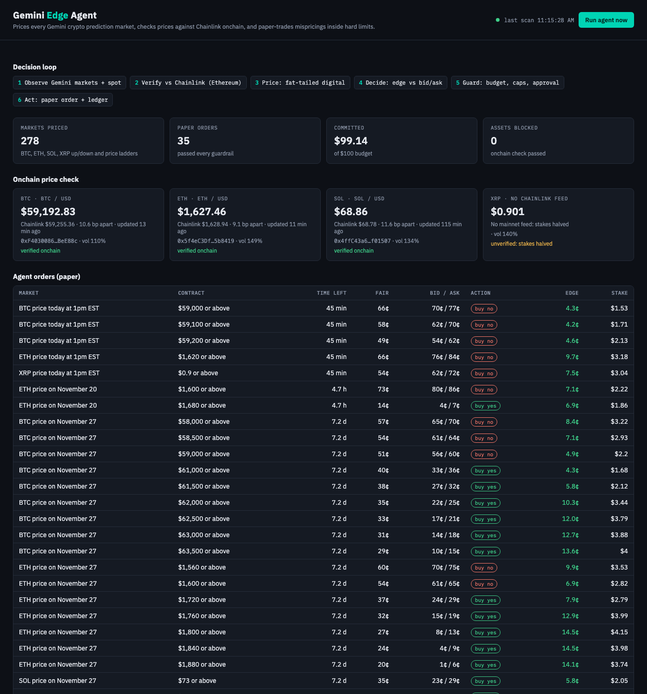
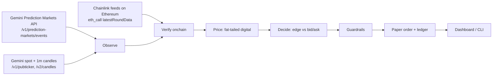

# Gemini Edge Agent

**An AI trading agent for Gemini Prediction Markets.** It prices every live crypto prediction contract on Gemini, verifies the price of the underlying against **Chainlink feeds read directly from Ethereum**, and paper-trades the mispricings it finds, inside hard spending limits.

Built for the University Blockchain Conference 2026 hackathon.

| | |
|---|---|
| **Main track** | Agentic Payments and AI |
| **Chain award** | None |
| **Bounties** | Gemini Prediction Markets |
| **Team** | Kailen Vyas |



---

## What it does

Gemini lists short-dated crypto prediction markets, such as "Will BTC be up at 12:15pm?" or "BTC price today at 1pm: $59,300 or above?", for BTC, ETH, SOL and XRP. Each of those contracts is a **digital option**: it pays $1 if the price finishes at or above a level. So it has a fair value that can be computed.

Every scan, the agent:

1. **Observes.** It pulls every open crypto contract from the Gemini Prediction Markets API (about 250–300 contracts per scan), plus spot prices and 1-minute candles from Gemini.
2. **Verifies onchain.** It reads the latest **Chainlink** BTC/USD, ETH/USD and SOL/USD prices straight from Ethereum mainnet with `eth_call` (`latestRoundData()`). If Gemini's price and the onchain price disagree too much, or the onchain price is stale, that asset is **blocked**.
3. **Prices.** Fair value = P(price at expiry ≥ strike). It uses a volatility forecast from recent 1-minute returns and a **fat-tailed (Student-t) distribution**, because crypto moves are far from normal.
4. **Decides.** It compares fair value with Gemini's bid and ask. "Buy YES" is worth it if fair − ask is large enough; "buy NO" if bid − fair is.
5. **Guards.** It checks budget, per-market caps, minimum edge, spread, time to expiry, and human approval above a size limit.
6. **Acts.** It writes a paper order to `output/ledger.jsonl` and shows it on the dashboard.

## Run it

```bash
git clone https://github.com/kailenvyas121/gemini-edge-agent.git
cd gemini-edge-agent
python3 -m venv .venv && source .venv/bin/activate
pip install -r requirements.txt

python server.py          # dashboard at http://localhost:8000 (refreshes every 30 s)
python run.py             # one scan in the terminal
python run.py --loop 5    # scan every 5 minutes
pytest -q                 # 30 offline tests (no network)
LIVE=1 pytest -q tests/test_live.py   # live sanity checks against Gemini + Ethereum
```

No API keys are needed. Gemini market data and Chainlink reads (via a public Ethereum RPC) are free.

## Testing

Every push runs the suite in GitHub Actions (`.github/workflows/ci.yml`).

| Layer | File | What it proves |
|---|---|---|
| Unit | `tests/test_unit.py` | Each function on its own: closed-form pricing matches a 1M-path Monte Carlo; ladders are monotone; volatility recovers a known value and damps bid-ask bounce; the parser handles a **real Gemini API payload** (labels match strikes, bid ≤ ask, prices in 0–1); "buy NO" = 1 − best bid holds across the payload; the Chainlink decoder reads a **real `eth_call` result** |
| Integration | `tests/test_integration.py` | The whole decision loop with the network mocked: it buys when edge is real; every guardrail blocks what it should (oracle divergence, mislabeled feed, wide book, last minutes, approval, budget never exceeded); the ledger records only orders |
| End to end | `tests/test_e2e.py` | Real server → real API → agent → page rendered in **headless Chrome**: KPI cards, orders, onchain check and guardrails all appear; API errors show in the UI instead of crashing it |
| Performance | `tests/test_performance.py` | 300 contracts priced in < 50 ms; a full decision loop in < 200 ms; cached dashboard API response in < 50 ms |
| Live sanity | `tests/test_live.py` (opt-in) | Against real APIs: each Chainlink feed names the right asset and has 8 decimals; Gemini ticker, Gemini candles and Chainlink agree; every live contract is well formed; a live scan finishes in < 20 s and respects every limit |

## Architecture



| File | Role |
|---|---|
| `edge/gemini.py` | Gemini Prediction Markets client: paginates every active crypto event and normalizes each contract (asset, up/down vs price ladder, strike, expiry, bid/ask, settlement index) |
| `edge/onchain.py` | Reads Chainlink aggregator contracts on Ethereum mainnet over JSON-RPC: `latestRoundData()` and `description()` |
| `edge/pricer.py` | Volatility forecast (EWMA of 5-minute returns) and fat-tailed digital pricing |
| `edge/agent.py` | The decision loop and guardrails |
| `server.py`, `web/index.html` | Dashboard: standard-library HTTP server plus a single HTML page |
| `run.py` | Command-line runner |
| `tests/` | Offline tests for the pricing math and each guardrail |

## Onchain: what the agent reads

| Feed | Contract (Ethereum mainnet) | Call |
|---|---|---|
| Chainlink BTC / USD | `0xF4030086522a5bEEa4988F8cA5B36dbC97BeE88c` | `latestRoundData()` `0xfeaf968c`, `description()` `0x7284e416` |
| Chainlink ETH / USD | `0x5f4eC3Df9cbd43714FE2740f5E3616155c5b8419` | same |
| Chainlink SOL / USD | `0x4ffC43a60e009B551865A93d232E33Fce9f01507` | same |

The agent has no onchain feed configured for XRP, so XRP trades are allowed but their stake cap is halved. All three feeds report 8 decimals (checked with `decimals()`), and the agent blocks an asset if a feed's `description()` doesn't name that asset or its price isn't positive.

**Why onchain:** the agent shouldn't trust a single exchange price. Chainlink is a decentralized, independently published price, so a bad print, a stale feed or a manipulated venue shows up as a gap between the two, and the agent stops trading that asset.

## The decision loop and its safety limits

| Guardrail | Default | Why |
|---|---|---|
| Budget per run | $100 | Hard cap on total premium committed |
| Max per market | $10 (half for assets without an onchain check) | No single contract can hurt much |
| Minimum edge | 4¢ | Buffer for fees, slippage and model error |
| Max spread | 15¢ | Wide books mean the price isn't reliable |
| No trades in the final | 2 minutes | Fast traders pick off quotes near expiry |
| Model horizon | 24 hours | The short-term volatility model is only trusted out to a day; longer contracts are priced and shown but not traded |
| Onchain divergence limit | 150 bp | Gemini vs Chainlink. Chainlink updates on a ~0.5% move or a heartbeat, so smaller gaps are normal |
| Onchain staleness limit | 24 h | Block the asset if the onchain price is too old |
| Human approval | above $25 | Large orders need a person to say yes |
| Mode | paper only | No live orders are sent |

**Sizing:** quarter-Kelly on the model's edge, then capped by the limits above.

**Kill switches:** an asset is blocked on any onchain failure. If every asset is blocked, the run halts.

Every guardrail has an offline test in `tests/test_agent.py`.

## How the pricing works (short)

A contract paying $1 if the price at expiry is at or above K is worth

  fair = P(S_T ≥ K) = 1 − F_ν( ln(K/S) / (σ·√τ) )

- S is spot, τ is minutes to expiry, and σ is per-minute volatility from an exponentially weighted average of recent 5-minute returns (1-minute prices bounce between bid and ask and overstate volatility).
- F_ν is a Student-t distribution with ν = 4.5, scaled to unit variance. The fat tails matter: a normal distribution overprices contracts that need a modest move and underprices big-move contracts.
- For an up/down window that hasn't started, the strike is the price at the start, so fair ≈ 50%.
- Drift is zero over minutes.

## Known limits

- Gemini settles on its own index (e.g. `LS-LRRR-XBTUSD`); the agent prices off Gemini spot. Measuring that small basis is a next step.
- Paper trading only. Live trading would use Gemini's authenticated order endpoints behind the same guardrails.
- The volatility model is deliberately simple (no time-of-day or macro-event adjustment yet).

---

## Devpost answers

**What did you build?** An AI agent for Gemini Prediction Markets. Every scan it prices all live crypto contracts (BTC, ETH, SOL, XRP up/down windows and price ladders), verifies each asset's price against Chainlink feeds read from Ethereum, and paper-trades contracts where Gemini's price is far from fair value. A live dashboard shows each decision and every guardrail.

**What problem does it solve?** Prediction-market prices on short-dated crypto contracts can be wrong, and most traders can't price a digital option in their head. Automated agents that trade them need a fair value and hard safety rails: a trusted reference price, spending limits and human sign-off. This agent provides all three in the open.

**How does it work?** Gemini's Prediction Markets API supplies contracts and order books; Gemini spot and candles supply price and volatility. Chainlink aggregator contracts on Ethereum are read with `eth_call` as an independent price check. A fat-tailed digital-option model computes fair value. The agent compares that with the bid and ask, sizes with quarter-Kelly, and runs every order through the guardrails before logging it.

**What makes it unique?** It treats prediction contracts as the options they are and prices them with a fat-tailed model, not a coin flip or sentiment. It also refuses to trade on an exchange price that the blockchain doesn't confirm. Every decision, including the ones it skips and why, is visible.

**What would you build next?**
- Live order routing through Gemini's trading API, behind the same guardrails, with an onchain USDC budget wallet so spending limits are enforced by the chain, not just the code.
- A perpetual team-strength index for sports. Gemini lists many game and season markets per team, and those could be combined into one continuous 0–100 score per team that doesn't expire with any single event: a clean, investable signal across a whole league.
- Measuring the gap between Gemini's settlement index and spot, and adding time-of-day volatility.

**Technologies:** Python, NumPy, SciPy, Gemini Prediction Markets API, Gemini market data API, Chainlink price feeds on Ethereum mainnet (JSON-RPC `eth_call`), HTML/JS dashboard.

## Demo video script (2–3 minutes)

1. **(0:00–0:20) The problem.** "Gemini lists crypto prediction markets like 'BTC above $59,300 at 1pm'. These are options, and they can be mispriced. I built an agent that prices them and trades the gaps safely."
2. **(0:20–1:00) The dashboard.** Run `python server.py` and open `localhost:8000`. Show the decision loop, the number of markets priced, and the onchain check cards: Gemini price vs Chainlink price read from Ethereum, the gap in basis points, and the feed address.
3. **(1:00–1:50) Decisions.** Show the paper-orders table: fair value vs bid/ask, the edge and the stake. In the all-markets table, tick "only |edge| ≥ 3¢" and point to rows the agent skipped and why (book too wide, too close to expiry, edge too small).
4. **(1:50–2:30) Safety.** Scroll to the guardrails. Run `pytest -q` to show the guardrail tests pass, including the one where a fake onchain price blocks all trading.
5. **(2:30–2:50) Next.** Live trading behind the same rails, an onchain USDC budget wallet, and a perpetual sports team index built from Gemini markets.
